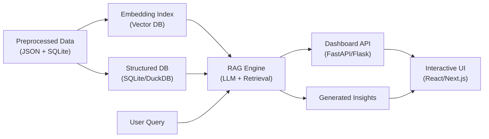
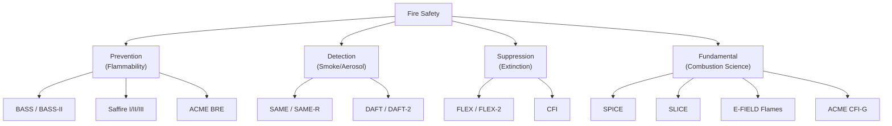

# 🔥 FireOrbit — NASA Combustion Dashboard: Strategy & Preprocessing Guide

## 1. Data Inventory — What You Have

You've collected **17 investigations** from the PSI database across three fire-safety pillars:

| Pillar | Investigations | PSI IDs |
|--------|---------------|---------|
| **Prevention (Flammability)** | BASS, BASS-II, Saffire-I/II/III, ACME BRE, ACME CFI-G | 26, 25, 98, 99, 100, 20, 159 |
| **Detection (Smoke/Aerosol)** | SAME, SAME-R, DAFT/DAFT-2 | 102, 101, 47 |
| **Suppression (Extinction)** | FLEX, FLEX-2, CFI | 69, 68, 39 |
| **Fundamental Combustion** | SPICE, SLICE, E-FIELD Flames | 107, 106, 22 |

### Per-investigation data files you have:
| File Type | Content | Format |
|-----------|---------|--------|
| `i_Investigation*.txt` | Rich metadata: objectives, hypotheses, approach, publications, hardware, design descriptors | ISA-Tab (tab-separated, section-based) |
| `PSI-*_Experimental table_*.csv` | Per-test experimental parameters (fuel, O₂%, flow, pressure, results) | CSV (schema varies per investigation) |
| `*.pdf` | Final science reports, 30-day post-flight reports, fact sheets | PDF (~20 files) |
| Researcher's Guide PDF | 50+ page overview of NASA ISS combustion research | PDF |

---

## 2. Preprocessing Pipeline

### Phase 1: Structured Metadata Extraction (from `i_Investigation*.txt`)

These ISA-Tab files are your **gold mine** for the AI layer. Parse each one to extract:

```
For each investigation, extract:
├── psi_id                  # e.g., "PSI-100"
├── title                   # "Spacecraft Fire Experiment-III"  
├── acronym                 # "SAFFIRE-III"
├── approach                # Free text (detailed methodology)
├── hypothesis              # Free text
├── objective               # Free text (often numbered)
├── research_impacts        # Free text (space + terrestrial applications)
├── sub_research_area       # "Spacecraft Fire Safety", "Laminar Flames", etc.
├── hardware                # "CIR", "MSG", "Saffire enclosure in Cygnus"
├── flight_platform         # "ISS" (all of them)
├── start_date / end_date
├── design_descriptors[]    # Tags: "Flame Spread", "Fire Safety", "Soot", etc.
├── publications[]          # DOI, title, authors, link
└── doi                     # Dataset DOI
```

**How to parse**: Write a Python script that reads each file line-by-line, looks for `Comment[...]` and `Study ...` prefixes, and populates a dictionary. Tab-separated values within a line represent multi-valued fields.

### Phase 2: Experimental Table Normalization (from CSVs)

> [!WARNING]
> This is the hardest preprocessing step. Each CSV has a **different schema**. There is no universal column set.

**Strategy**: Don't force a single flat table. Instead, create a **two-level structure**:

**Level 1 — Universal columns** (normalize across all investigations):
| Column | Source Examples | Notes |
|--------|---------------|-------|
| `investigation_id` | PSI-100, PSI-69 | Link back to metadata |
| `test_id` | Sample Number, FLEX Test #, Test # | Investigation-specific test identifier |
| `fuel_type` | SIBAL Fabric, Methanol, PMMA, Ethylene, n-Octane | Standardize names |
| `fuel_state` | solid, liquid, gas | Derive from investigation context |
| `fuel_geometry` | film, rod, sphere, sheet, droplet, jet | Derive from material + investigation |
| `o2_concentration` | 0.21, 0.265, 0.34, 0.40, 0.85 | Normalize to mole fraction (0-1) |
| `pressure_atm` | 1.0, 0.69, 0.56 | Normalize psi → atm |
| `flow_velocity_cm_s` | 0, 5, 20, 30, 40 | cm/s, NaN for quiescent |
| `flow_direction` | concurrent, opposed, quiescent | Standardize |
| `gravity_level` | microgravity, normal, partial-emulated | |
| `diluent_gas` | N₂, He, CO₂ | |
| `outcome_category` | ignition, sustained_burn, extinction, self-extinction, suppressed | |

**Level 2 — Investigation-specific columns** (keep as JSON or separate tables):
- FLEX: droplet diameter, burning rate, burn time, extinction diameter
- BASS/BASS-II: O₂ initial/final, CO₂, CO, radiometer gain, spread rate
- Saffire: sample dimensions, ignition power, burn length
- CFI-G: Zst, Tad, cool flame flag, peak burner temperature
- BRE: burner size, fuel bottle composition
- SPICE: nozzle diameter, smoke point, flame length

### Phase 3: PDF Text Extraction

Use `PyMuPDF` (fitz) or `pdfplumber` to extract text from each PDF report. Store as:
```
{
  "investigation_id": "PSI-20",
  "source_file": "BRE_final_report_20220201.pdf",
  "full_text": "...",
  "sections": {  // attempt to split by headings
    "abstract": "...",
    "results": "...",
    "conclusions": "...",
    "recommendations": "..."
  }
}
```

### Phase 4: Build the Knowledge Base JSON

Combine everything into a single structured JSON (or SQLite database):

```json
{
  "investigations": [
    {
      "psi_id": "PSI-100",
      "title": "Spacecraft Fire Experiment-III",
      "acronym": "SAFFIRE-III",
      "fire_safety_pillar": "prevention",
      "relevance_to_crew_safety": "direct",  // you assign this
      "metadata": { ... },           // from Phase 1
      "experiments": [ ... ],        // from Phase 2
      "report_text": { ... },        // from Phase 3
      "publications": [ ... ],
      "hardware_group": "Saffire/Cygnus",
      "related_investigations": ["PSI-98", "PSI-99"]
    }
  ]
}
```

---

## 3. AI/SI Strategy — How to Solve This with AI

### Architecture: RAG + Structured Analytics



### Layer 1: Embedding & Vector Search (for "summarize and interpret")

1. **Chunk the text** from investigation descriptions, objectives, hypotheses, approach, impacts, and PDF reports
2. **Embed** each chunk using an embedding model (options below)
3. **Store** in a vector database (ChromaDB, FAISS, or Pinecone)
4. **At query time**: user asks a question → retrieve top-k relevant chunks → feed to LLM with context → generate answer

**What this enables on the dashboard:**
- "Which investigations studied flammability at oxygen levels ≥30%?" 
- "What are the key findings for fire suppression in microgravity?"
- "How do BASS and Saffire results compare for PMMA-like materials?"

### Layer 2: Structured Analytics (for "rank and compare")

Use the normalized experimental tables to power **data-driven visualizations**:

| Dashboard Feature | Data Source | AI Role |
|-------------------|------------|---------|
| **Investigation Relevance Ranking** | Metadata + manual scoring | LLM assigns relevance scores based on objective alignment with crew safety |
| **O₂ Concentration Coverage Map** | Experimental tables | Chart which investigations tested at which O₂ levels |
| **Material Flammability Matrix** | BASS, BASS-II, Saffire, BRE | Compare ignition/extinction outcomes across materials |
| **Condition Comparison Radar** | All experimental tables | Spider chart comparing test parameter ranges |
| **Hardware Lineage Tree** | Metadata | Interactive tree: CIR → ACME → BRE/E-FIELD/CFI-G etc. |
| **Publication Network** | Publications data | Who cites whom, cross-investigation authors |

### Layer 3: LLM-Powered Features (the "SI" part)

| Feature | Implementation |
|---------|----------------|
| **Natural Language Q&A** | RAG over all text data. User types a question, gets an answer with citations to specific investigations and publications |
| **Auto-Generated Investigation Summaries** | For each investigation, generate a 200-word plain-English summary from the metadata + reports |
| **Cross-Investigation Comparison** | "Compare FLEX and CFI for droplet combustion" → LLM synthesizes from both datasets |
| **Fire Safety Recommendations** | Prompt-engineered output: "Given planned Moon Base at 30% O₂, 10.2 psi, which materials are safe based on PSI data?" |
| **Predictive Insight Cards** | LLM identifies data gaps: "No partial-gravity combustion data exists in PSI yet. Upcoming: LUCI, FM2" |
| **Earth Application Finder** | Given a terrestrial fire safety problem, find relevant microgravity findings |

---

## 4. Recommended AI/LLM Options

### Option A: Gemini API (Recommended for hackathon)
- Use **Gemini 2.5 Flash** for fast, cheap inference
- Supports huge context windows (1M tokens) — you can stuff entire investigation texts into context
- Free tier generous enough for a hackathon demo
- **Advantage**: Can skip the vector DB entirely for a prototype — just load all your preprocessed JSON into the context window

### Option B: OpenAI API
- GPT-4o or GPT-4o-mini for the RAG pipeline
- Good function-calling for structured data extraction

### Option C: Local/Open Source
- Use Ollama with Llama 3 or Mistral for fully offline operation
- Pair with ChromaDB for vector search

> [!TIP]
> **For a hackathon, Option A (Gemini) is strongest.** The 1M-token context window means you can load ALL 17 investigation descriptions + experimental tables directly into the prompt without needing a vector database at all. This dramatically simplifies your architecture.

---

## 5. Relevance Scoring Algorithm

A key challenge ask is to **rank investigations by relevance to fire safety**. Here's a scoring framework:

```
relevance_score = (
    w1 * direct_fire_safety_tag     # 1 if SubResearchArea == "Spacecraft Fire Safety"
  + w2 * crew_environment_relevance # 1 if tests crew-relevant conditions (O₂ 21-34%, solid/fabric fuels)
  + w3 * elevated_o2_coverage       # 1 if tested at ≥ 26.5% O₂
  + w4 * solid_fuel_testing         # 1 if fuel_state == "solid"
  + w5 * suppression_data           # 1 if includes extinction/suppression results
  + w6 * detection_data             # 1 if smoke/aerosol measurement
  + w7 * publication_count          # normalized 0-1
  + w8 * practical_application      # 1 if research_impacts mentions terrestrial use
)
```

| Weight | Factor | Suggested Value |
|--------|--------|-----------------|
| w1 | Direct fire safety tag | 0.20 |
| w2 | Crew-environment relevance | 0.20 |
| w3 | Elevated O₂ coverage | 0.15 |
| w4 | Solid fuel testing | 0.15 |
| w5 | Suppression data | 0.10 |
| w6 | Detection data | 0.10 |
| w7 | Publication count (normalized) | 0.05 |
| w8 | Earth applications | 0.05 |

This can also be done by the LLM — have it score each investigation 1-10 on each factor and explain why.

---

## 6. Investigation Groupings for the Dashboard

### By Fire Safety Pillar


### By Hardware Platform
| Hardware | Investigations |
|----------|---------------|
| MSG + SPICE flow duct | BASS, BASS-II, SPICE, SLICE |
| CIR + ACME | BRE, E-FIELD, CFI-G (+ 3 other ACME studies) |
| CIR + MDCA | FLEX, FLEX-2, CFI |
| Cygnus vehicle | Saffire-I, II, III |
| MSG (standalone) | SAME, SAME-R, DAFT |

### By Fuel Phase
| Phase | Investigations | Materials |
|-------|---------------|-----------|
| Solid | BASS, BASS-II, Saffire-I/II/III | PMMA, SIBAL fabric, cotton/fiberglass, Nomex, silicone |
| Liquid | FLEX, FLEX-2, CFI | Methanol, heptane, octane, decane, dodecane |
| Gas | SPICE, SLICE, BRE, E-FIELD, CFI-G | Methane, ethylene, propane, n-butane, propylene |
| Aerosol/Smoke | SAME, SAME-R, DAFT | Teflon, Kapton, Pyrell, cotton pyrolysis products |

---

## 7. Key Data Gaps to Highlight on Dashboard

> [!IMPORTANT]
> These are differentiators the challenge explicitly calls out:

1. **No partial-gravity data in PSI** — Moon (1/6g) and Mars (3/8g) combustion is untested. Upcoming: LUCI, FM2
2. **E-FIELD mimicked partial gravity** via electric fields on flame ions — only proxy available
3. **O₂ range 26.5%-34%** is the critical "Moon Base zone" — check which investigations cover it:
   - BRE: tested at 21%, 26.5%, 34%, 40% ✅
   - CFI-G: up to 85% O₂ ✅
   - Most others: tested at ~21% only
4. **Pressure range 8.2-10.2 psi** (Moon Base) — most ISS tests at ~1 atm (14.7 psi)
5. **Quiescent (no airflow) burning** — BRE specifically tested this; critical because "cut the ventilation" is a suppression strategy

---

## 8. Tech Stack Recommendation

```
Frontend:   Next.js + React + Tailwind + Recharts/D3.js
Backend:    Python FastAPI
Database:   SQLite (structured data) + ChromaDB (vectors, optional)
AI:         Gemini 2.5 Flash API (or local Ollama for offline demo)
PDF Parse:  PyMuPDF or pdfplumber  
Deploy:     Vercel (frontend) + Railway/Render (backend)
```

### Dashboard Pages/Views

1. **Overview** — All 17 investigations as cards with fire-safety-pillar color coding, relevance scores, key stats
2. **Investigation Deep Dive** — Click an investigation → AI-generated summary, experimental parameter table, publications, related investigations
3. **Compare** — Side-by-side comparison of 2-3 investigations (conditions, outcomes, hardware)
4. **Explore by Condition** — Filter/search by O₂ level, fuel type, flow velocity, gravity → see which experiments match
5. **AI Chat** — Natural language Q&A over the entire corpus
6. **Fire Safety Insights** — Pre-computed "insight cards" for Moon Base, Mars, ISS scenarios
7. **Earth Applications** — Terrestrial fire safety spinoffs from microgravity research

---

## 9. Preprocessing Script Outline

```python
# Suggested preprocessing steps (pseudocode):

# Step 1: Parse ISA-Tab investigation files
for folder in investigation_folders:
    metadata = parse_isa_tab(folder / "i_Investigation*.txt")
    # Extract: title, acronym, approach, hypothesis, objective,
    #          impacts, hardware, dates, descriptors, publications
    
# Step 2: Parse & normalize CSV experimental tables  
for folder in investigation_folders:
    csv_file = find_csv(folder)
    raw_df = pd.read_csv(csv_file)
    normalized = normalize_columns(raw_df, investigation_type)
    # Map to universal schema + keep investigation-specific fields
    
# Step 3: Extract PDF text
for pdf in all_pdf_files:
    text = extract_text(pdf)  # PyMuPDF
    sections = split_by_headings(text)
    
# Step 4: Build unified knowledge base
knowledge_base = {
    "investigations": [...],  # metadata + experiments + text
    "cross_references": {...},  # hardware groups, shared authors
    "condition_index": {...}  # inverted index: O₂ level → investigations
}

# Step 5: Generate embeddings (optional, for RAG)
chunks = chunk_all_text(knowledge_base)
embeddings = embed(chunks)  # Gemini embedding API or sentence-transformers
vector_db.insert(chunks, embeddings)

# Step 6: Pre-generate AI summaries
for inv in knowledge_base["investigations"]:
    inv["ai_summary"] = llm.generate(
        f"Summarize this investigation's key findings for spacecraft fire safety: {inv}"
    )
    inv["relevance_score"] = compute_relevance(inv)
```

---

## 10. Winning Differentiators

> [!TIP]
> What will make your dashboard stand out:

1. **"Moon Base Mode"** — Toggle to filter all data to conditions relevant to lunar habitat (30% O₂, 10.2 psi, reduced gravity). Show which investigations provide data, and where the gaps are.
2. **Cross-investigation synthesis** — Don't just display data per investigation. Show: "For PMMA at 21% O₂, BASS found X spread rate, while BRE found Y burning rate — together this implies Z."
3. **Predictive gap analysis** — "Based on available data, we can predict flame behavior at 30% O₂ in microgravity. For 1/6g (Moon), no data exists — this is where LUCI and FM2 will contribute."
4. **The "what-if" engine** — User sets O₂%, pressure, flow, material → AI predicts flammability risk based on interpolation/extrapolation of existing data, with confidence intervals.
5. **Historical context timeline** — Apollo 1 (1967) → Mir fire (1997) → SAME (2001) → BASS (2009) → Saffire (2016) → LUCI (upcoming). Show the arc of fire safety research.
