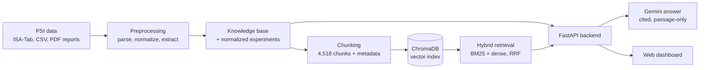

# 🔥 FireOrbit
 
**Spacecraft fire-safety evidence, searchable, comparable and traceable.**
FireOrbit turns NASA's Physical Science Informatics (PSI) combustion data into an interactive dashboard and AI assistant for crewed space exploration. Built for the **NASA Space Apps Challenge 2026**.
 
- **Live dashboard:** https://fireorbit.vercel.app
- **Demo video:** https://youtu.be/3xwqfYmuXP0
> FireOrbit is a research aid. It is **not** a substitute for NASA flammability certification.
 
---
 
## Why
 
Fire is one of the most dangerous risks on crewed missions, and decades of microgravity combustion results sit scattered across PDF reports and experiment tables. Moon Base cabins are expected to run at higher oxygen and lower pressure than Earth air, which makes materials more flammable, yet little data exists at those conditions. FireOrbit helps mission planners and researchers see **what is known, what is uncertain, and what still needs testing**.
 
## What it does
 
| Tab | What you can do |
|---|---|
| **Overview** | See all 16 investigations grouped by safety pillar (Prevention, Detection, Suppression, Fundamental). |
| **Rank** | Rank investigations by relevance and by Moon Base applicability. |
| **Explore data** | Filter 1,589 normalized tests by oxygen %, pressure, flow, fuel and outcome. |
| **Compare** | Put investigations side by side (fuels, conditions, hardware, outcomes). |
| **Ask FireOrbit** | Ask questions in plain English. Answers are written by Gemini **only from retrieved passages** and carry numbered citations. |
| **Gaps & Earth** | See what the data cannot answer (for example partial gravity, Moon-cabin conditions) and how the research applies on Earth. |
 
Also included: an evidence-based **what-if** tool that estimates burn likelihood from the nearest real experiments, with a confidence level and warnings for extrapolation, missing pressure data and the absence of partial-gravity data.
 
## How it works
 

 
1. **Data pipeline** (`preprocessing/`): parses ISA-Tab investigation files, normalizes experiment CSVs, extracts text from PDF reports, and builds a knowledge base. Values the pipeline had to assume are flagged.
2. **Chunking** (`chunking/`): 4,518 chunks = 2,777 report-text chunks, 1,589 experiment records and 152 investigation-description chunks. Experiment chunks get structured metadata (`o2_pct`, `fuel`, `outcome`, ...).
3. **Retrieval** (`embedding/retrieval.py`): BM25 and dense vector search merged by reciprocal-rank fusion. A rule-based **query router** turns phrases such as "85% oxygen", "methanol tests" or "self-extinguished" into metadata filters, so counting questions ("how many tests...") are answered from metadata rather than guessed.
4. **Answers** (`llm/`): Gemini is instructed to use only the numbered passages, cite every claim, and refuse (or say what is missing) when the context does not answer the question. Greetings and out-of-scope questions are handled without inventing answers.
5. **Backend** (`backend/`): FastAPI serving dashboard data, analytics, search, chat and the what-if engine.
6. **Dashboard** (`index.html`, `app.js`, `api.js`): static vanilla-JS app.
### Fallbacks
 
FireOrbit keeps working when parts of the stack are unavailable:
 
- **No vector index or embedding libraries** (for example on a small free server): the backend switches from hybrid to keyword search over the same chunks. `GET /health` reports `retrieval_mode`.
- **No `GEMINI_API_KEY`:** the chat endpoint returns the retrieved passages without a generated answer.
- **Backend unreachable:** the dashboard loads an offline snapshot (`data.js`) and the Ask tab searches it locally by keyword. A status badge shows which mode is active.
## Quick start
 
Requires Python 3.11+.
 
```bash
git clone https://github.com/Shrouk-Sharaf/FireOrbit.git
cd FireOrbit
python -m pip install -r requirements.txt
```
 
Create a `.env` file in the repo root (it is gitignored):
 
```
GEMINI_API_KEY=your_key_here        # https://aistudio.google.com/apikey
# GEMINI_MODEL=...                  # optional: override the default model
# CORS_ORIGINS=https://your-site    # optional: comma-separated, default is *
```
 
Run the backend, then the dashboard:
 
```bash
# 1) backend, from the repo root  ->  http://127.0.0.1:8000/docs
python -m uvicorn backend.main:app --reload
 
# 2) dashboard, from the repo root  ->  http://localhost:5500
python -m http.server 5500
```
 
The first run downloads the embedding model (`BAAI/bge-small-en-v1.5`, about 130 MB). The vector index is committed in `index/chroma/`, so you do not need to rebuild it. Without `GEMINI_API_KEY` the app still works, but the Ask tab shows retrieved passages instead of written answers.
 
Check the backend: open `http://127.0.0.1:8000/health`. It should report `"vector_search": true` and `"retrieval_mode": "hybrid"`.
 
## Ask from the command line
 
```bash
python ask.py "which test reached 85% oxygen"
python ask.py "what was the objective of SPICE" --top-k 6 --show-chunks
python ask.py "..." --dry-run          # retrieve and print the prompt, no LLM call
python embedding/retrieval.py "methanol experiments that ended in extinction" --top-k 8
```
 
## Rebuild the pipeline (optional)
 
Only needed if you change the source data.
 
```bash
python preprocessing/run_all.py                 # parse ISA-Tab, normalize CSVs, extract PDFs, build knowledge base
python chunking/recursive_chunking.py           # writes chunking/chunks.json
python chunking/enrich_metadata.py              # adds o2_pct / fuel / outcome metadata to experiment chunks
python embedding/build_index.py                 # writes index/chroma (rebuilds the collection from scratch)
```
 
Use `--help` on each script for options. If you change the embedding model, pass the same `--model` to `embedding/retrieval.py`.
 
## API overview
 
| Dashboard page | Endpoints |
|---|---|
| Overview | `GET /api/overview`, `GET /api/investigations` |
| Deep dive | `GET /api/investigations/{id}`, `/api/investigations/{id}/summary` |
| Compare | `GET /api/compare?ids=PSI-20,PSI-69`, `/api/analytics/radar?ids=` |
| Explore by condition | `GET /api/experiments/facets`, `GET /api/experiments?o2_min=&fuel=...` |
| Charts | `/api/analytics/o2-coverage`, `/material-matrix`, `/hardware-lineage`, `/publication-network` |
| Moon Base mode / gaps | `GET /api/moon-base`, `/api/gaps`, `/api/timeline` |
| Earth applications | `GET /api/earth-applications` |
| AI chat and search | `POST /api/chat`, `GET /api/search?q=` |
| What-if | `POST /api/what-if`, `GET /api/what-if/materials` |
| Health | `GET /health` |
 
## Project structure
 
```
FireOrbit/
├── DATA/                 source PSI data (ISA-Tab, CSVs, PDF reports) and strategy notes
├── preprocessing/        parse_isatab, normalize_csv, extract_pdfs, build_knowledge_base, run_all
├── data_processed/       knowledge_base.json, experiments_normalized.json, extracted_pdf_reports.json
├── chunking/             recursive_chunking.py, enrich_metadata.py, chunks.json
├── embedding/            build_index.py, retrieval.py (hybrid + router), eval_set.json, run_eval.py
├── index/chroma/         committed vector index (4,518 vectors)
├── llm/                  Gemini client, prompt rules, answer + citation formatting
├── backend/              FastAPI app (routers: investigations, analytics, ai)
├── index.html, app.js, api.js, data.js, styles.css    static dashboard
├── ask.py, run_answers.py                              CLI tools
└── test_llm_layer.py     tests (run with: python -m pytest)
```
 
## Evaluation and tests
 
- `embedding/eval_set.json` holds 41 questions (36 answerable, 5 deliberately unanswerable) with the expected investigations and chunks. `embedding/run_eval.py` scores retrieval against it, and `run_answers.py` runs the full retrieval + LLM path for manual review.
- `python -m pytest` runs the LLM-layer tests.
## Known limits
 
We state these openly because the tool is meant to be trusted only as far as the data allows.
 
- **No partial-gravity data** exists in PSI yet, so Moon (1/6 g) and Mars (3/8 g) behavior is not directly measured. Results are microgravity or 1-g analogues only.
- **Sparse data at Moon Base cabin conditions** (about 30% O₂ at 10.2 psi or less). Few investigations report elevated oxygen and reduced pressure together.
- **Many tests record no O₂, pressure or flow value** (for example BASS, SPICE, SAME-R). Filters on those fields cannot match them, and solid-material tests record no pressure at all.
- **Some oxygen values are not cabin air.** CFI-G inverse flames use an oxidizer stream of up to 85% O₂ supplied by the burner. Such records are flagged and should not be read as habitat atmospheres.
- **Some pressures are planned, not measured** (for example ACME BRE lists candidate pressures per test). Assumed and invalid values are flagged in the data.
- **Keyword fallback is weaker than hybrid search**, especially for numeric questions. Use the hybrid setup (the default when the index and models load) for best results.
- Answers are generated by an LLM from retrieved passages. Always check the cited source.
## Built with
 
Python, FastAPI, Pydantic, Uvicorn, pandas, PyMuPDF, rank-bm25, ChromaDB, sentence-transformers (`BAAI/bge-small-en-v1.5`), Google Gemini (`google-genai`), vanilla JavaScript, pytest. Frontend hosted on Vercel.
 
## Data and credits
 
- **Data:** NASA Physical Science Informatics (PSI), combustion investigations (ACME, BASS, BASS-II, CFI, DAFT, E-FIELD, FLEX, FLEX-2, SAFFIRE-I/II/III, SAME, SAME-R, SLICE, SPICE).
- **AI use:** Gemini powers the in-app answers and summaries. AI assistants were also used during development to help write and review code and documentation; the team reviewed and tested the results.
- This project is not affiliated with or endorsed by NASA.
